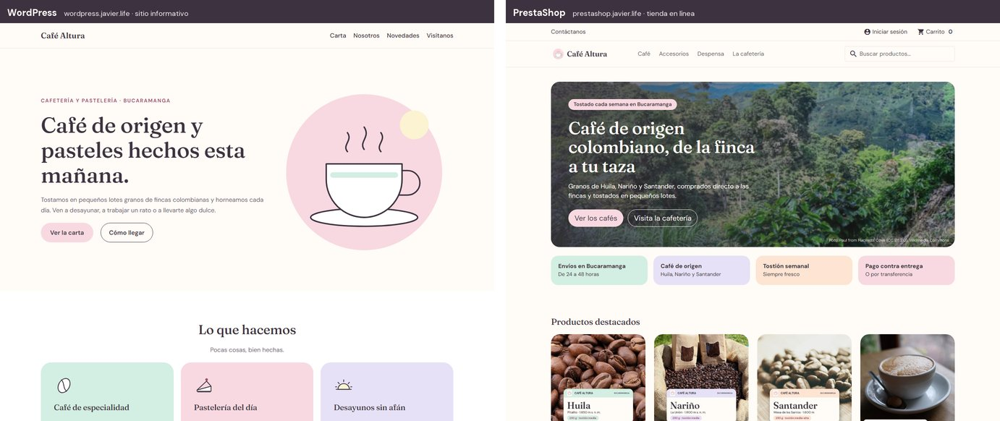
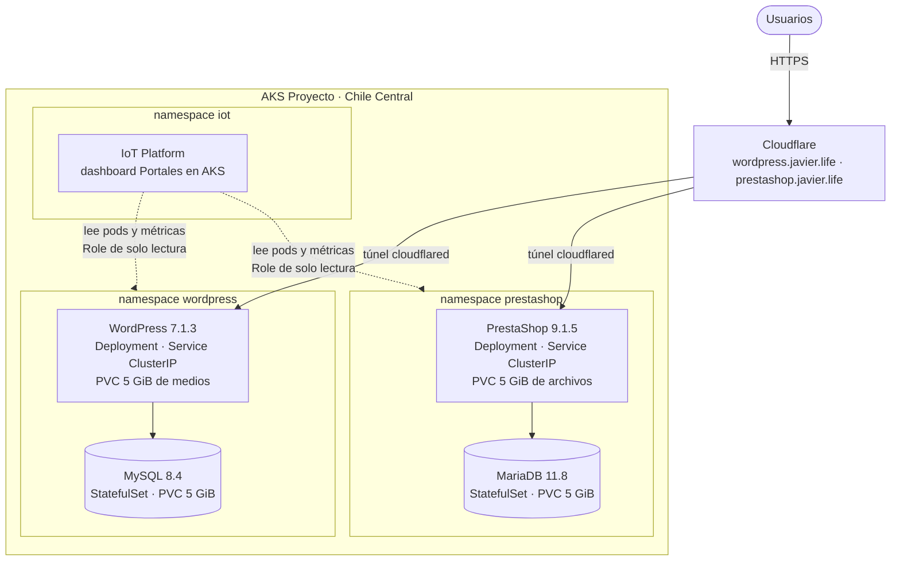
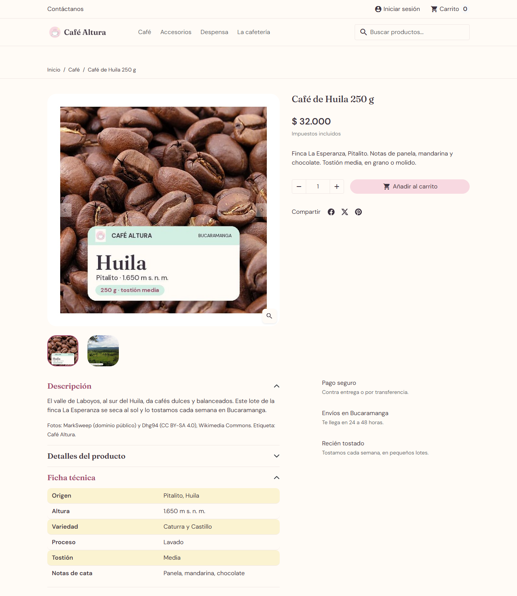
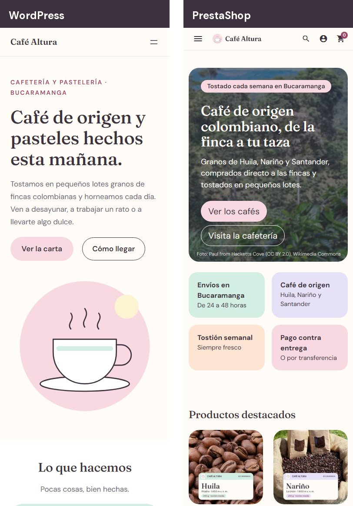
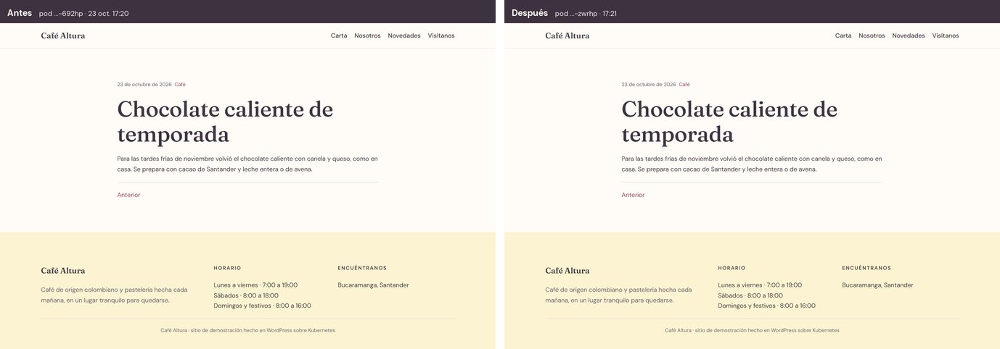
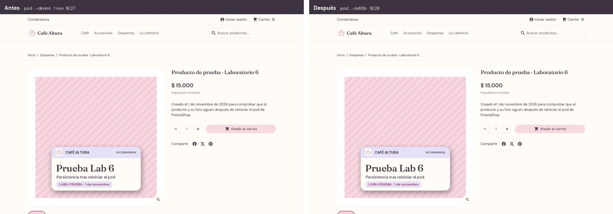
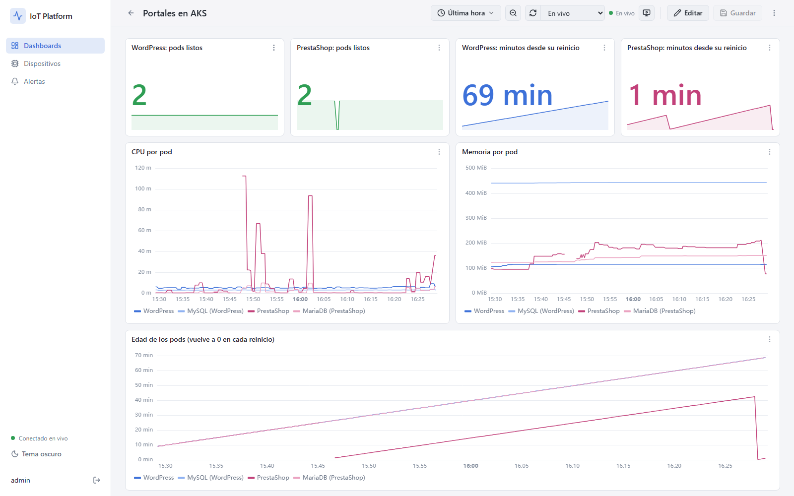

# Laboratorio — Multiplataforma en AKS: WordPress y PrestaShop

Dos portales independientes, cada uno con su propia base de datos, desplegados en el mismo clúster de Azure Kubernetes Service que IoT Platform. Los dos son de **Café Altura**, una cafetería de demostración en Bucaramanga: el sitio informativo en WordPress y la tienda en línea en PrestaShop. El monitoreo de los workloads lo hace IoT Platform, en lugar de Grafana.



| Portal | Aplicación | Base de datos | Dirección | Administración |
|---|---|---|---|---|
| Sitio informativo | WordPress 7.1.3, imagen y tema propios | MySQL 8.4 · namespace `wordpress` | https://wordpress.javier.life | `/wp-admin` · usuario `admin` |
| Tienda en línea | PrestaShop 9.1.5, imagen oficial | MariaDB 11.8 · namespace `prestashop` | https://prestashop.javier.life | carpeta secreta (Secret `prestashop`, clave `admin-folder`) · `admin@javier.life` |
| Monitoreo | IoT Platform, dashboard **Portales en AKS** | — | https://iot.javier.life | dispositivos `aks-wordpress` y `aks-prestashop` |

**Clúster:** AKS `Proyecto` · resource group `Javier` · Chile Central · Kubernetes 1.36.5 (nivel Free) · 2 nodos Standard_B2as_v2.

## Arquitectura



- **Separación:** cada portal tiene su namespace, su motor de base de datos, sus discos y su Secret. WordPress solo conoce `wordpress-db` y PrestaShop solo `prestashop-db`.
- **Exposición:** todos los Services son ClusterIP. Los portales salen a Internet solo por Cloudflare Tunnel, con HTTPS y sin IP pública propia, y ninguna base de datos se alcanza fuera del clúster.
- **Credenciales:** en Secrets de Kubernetes. El repositorio solo incluye `secretos.ejemplo.yaml`; `secretos.yaml` y `credenciales.local.txt` están en `.gitignore`.

## Contenido de la carpeta

```
laboratorio/
├── README.md
├── img/                          imágenes de este README
├── wordpress/                    imagen propia del sitio (la compila .\desplegar.ps1 wordpress con el BuildKit del clúster)
│   ├── Dockerfile                php:8.3-apache + WordPress 7.1.3 (verificado con sha1) + idioma es_CO + wp-cli + tipografías
│   ├── raiz/                     wp-config.php, .htaccess y favicon.ico (se copian a /var/www/html)
│   ├── tema/                     tema de bloques "Café Altura", sin PHP: theme.json, templates/, parts/, assets/, style.css
│   ├── seguridad/                apache.conf, php.ini de producción y seguridad.php (mu-plugin)
│   └── instalacion/              configurar-sitio.sh y contenido/ (páginas iniciales en bloques)
├── prestashop/                   configuración de la tienda, aplicada al instalar la imagen oficial
│   ├── instalacion/              instalar-tienda.sh (post-instalación) y tienda.php (identidad, moneda, catálogo, portada, menú, textos)
│   ├── tema/                     custom.css sobre el tema hummingbird, logo.png y favicon.ico
│   └── fotos/                    dos fotos por producto y la de portada (Wikimedia Commons)
├── kubernetes/
│   ├── wordpress.yaml            MySQL + WordPress, discos de 5 GiB, Services ClusterIP y permiso de lectura para IoT Platform
│   ├── prestashop.yaml           MariaDB + PrestaShop, discos de 5 GiB, Services ClusterIP y permiso de lectura para IoT Platform
│   └── secretos.ejemplo.yaml     plantilla de los dos Secrets
└── evidencias/                   capturas, checkpoints y registros de las pruebas de reinicio (ver la última sección)
```

## Despliegue

**Requisitos:** Azure CLI, `kubectl` y acceso al clúster (`az aks get-credentials -g Javier -n Proyecto`). No hace falta Docker: la imagen de WordPress se compila dentro del clúster.

```powershell
# 1. Namespaces y Secrets (copiar la plantilla y reemplazar cada valor CAMBIAR)
kubectl create namespace wordpress; kubectl create namespace prestashop
copy laboratorio\kubernetes\secretos.ejemplo.yaml laboratorio\kubernetes\secretos.yaml
kubectl apply -f laboratorio\kubernetes\secretos.yaml

# 2. WordPress: compila la imagen, la sube al ACR, despliega e instala el sitio.
#    La contraseña del panel entra por stdin y no queda guardada en el pod.
.\desplegar.ps1 wordpress
$c = kubectl get secret -n wordpress wordpress -o jsonpath='{.data.admin-password}'
[Text.Encoding]::UTF8.GetString([Convert]::FromBase64String($c)) | kubectl exec -i -n wordpress deploy/wordpress -- configurar-sitio

# 3. PrestaShop: configuración y fotos como ConfigMaps, luego el despliegue.
#    La instalación es automática (unos 3 minutos): kubectl logs -n prestashop deploy/prestashop -f  hasta "Tienda lista".
kubectl create configmap prestashop-tienda -n prestashop --from-file=laboratorio\prestashop\instalacion --from-file=laboratorio\prestashop\tema --dry-run=client -o yaml | kubectl apply -f -
kubectl create configmap prestashop-fotos -n prestashop --from-file=laboratorio\prestashop\fotos --dry-run=client -o yaml | kubectl apply --server-side -f -
kubectl apply -f laboratorio\kubernetes\prestashop.yaml

# 4. Monitoreo en IoT Platform (K8S_DEVICES=wordpress=aks-wordpress,prestashop=aks-prestashop)
kubectl apply -f kubernetes\backend.yaml
```

Las fotos van en su propio ConfigMap porque cada uno admite como máximo 1 MiB. Se aplican con `--server-side` porque el `apply` normal copia todo el contenido en una anotación, que no puede pasar de 256 KiB.

**Publicación:** en Cloudflare, Zero Trust → Networks → Tunnels → túnel `Kubernetes` → Published application routes, una ruta por portal:

| Dominio | Servicio |
|---|---|
| `wordpress.javier.life` | `http://wordpress.wordpress.svc.cluster.local:80` |
| `prestashop.javier.life` | `http://prestashop.prestashop.svc.cluster.local:80` |

Para ver WordPress sin el dominio: `kubectl port-forward -n wordpress svc/wordpress 8080:80` → http://localhost:8080. PrestaShop siempre redirige a su dominio.

## Los portales

### WordPress — sitio informativo

- **Contenido:** Inicio, Carta, Nosotros, Visítanos y un blog de novedades. Todo se edita desde el panel: páginas y entradas con el editor de bloques, y encabezado, pie, colores y tipografías en Apariencia → Editor.
- **Tema sin PHP:** son plantillas HTML de bloques más `theme.json`. El único PHP propio es `wp-config.php` y un plugin de seguridad.
- **Imagen inmutable:** el panel no deja instalar plugins ni temas. Los cambios de código se hacen en `laboratorio/wordpress` y se despliegan con `.\desplegar.ps1 wordpress`.

### PrestaShop — tienda en línea

- **Imagen oficial** `prestashop/prestashop:9.1.5-apache`. Se instala sola al arrancar con el disco vacío (`PS_INSTALL_AUTO=1`). En los arranques siguientes detecta la instalación ("PrestaShop Core already installed") y no reinstala.
- **Post-instalación propia** (`prestashop/instalacion/`), que la imagen ejecuta una sola vez. Deja la tienda así:
  - solo en español, con pesos colombianos escritos como en Colombia (`$ 32.000`);
  - una portada con foto, botones a los cafés y a la cafetería en WordPress, y una franja de confianza;
  - 5 productos en 3 categorías (Café, Accesorios y Despensa), cada uno con dos fotos, descripción y ficha técnica;
  - sin los datos de ejemplo del instalador (productos de ropa, marcas, proveedores, cliente y pedidos de demostración).
- **Disco de archivos:** PrestaShop guarda su configuración, módulos e imágenes en `/var/www/html`, así que ese directorio va en un disco propio. Sin él, cada reinicio reinstalaría la tienda.

<p align="center">
  
  <br><em>Ficha de producto: foto con la etiqueta del origen, foto del lugar real y ficha técnica.</em>
</p>

<p align="center">
  
  <br><em>Los dos portales en un teléfono (390 px de ancho).</em>
</p>

**Detalles de PrestaShop 9 que hubo que resolver:**

| Problema | Solución |
|---|---|
| El disco de Azure trae `lost+found` en la raíz y el instalador aborta al no poder leerlo | Un `initContainer` lo quita antes de arrancar |
| El instalador renombra la carpeta `admin/` por su cuenta | `PS_FOLDER_ADMIN` queda en `admin` y la post-instalación pone el nombre definitivo (`CARPETA_PANEL`) |
| Cloudflare guarda en caché las imágenes y los CSS por su URL | El logo y la foto de portada llevan un hash en el nombre, y el CSS combinado se regenera con un nombre nuevo |

Para repetir la configuración de la tienda (rehace el catálogo inicial y conserva el producto de prueba `LAB6-PRUEBA`):

```powershell
kubectl exec -n prestashop deploy/prestashop -c prestashop -- /tmp/post-install-scripts/instalar-tienda.sh
```

<details>
<summary><strong>Créditos de las fotos de la tienda</strong> (Wikimedia Commons)</summary>

| Archivo | Autor y licencia |
|---|---|
| `cafe-huila.jpg` · `cafe-huila-origen.jpg` | MarkSweep (dominio público) · Dhg94 (CC BY-SA 4.0) |
| `cafe-narino.jpg` · `cafe-narino-origen.jpg` | Jamain (CC BY-SA 4.0) · Jefersonkardenas (CC BY-SA 3.0) |
| `cafe-santander.jpg` · `cafe-santander-origen.jpg` | Daniel Ruswick (CC0) · EEIM (CC BY-SA 4.0) |
| `taza.jpg` · `taza-servida.jpg` | Edward (CC0) · Janko Ferlic (CC0) |
| `granola.jpg` · `granola-servida.jpg` | Shixart1985 (CC BY 2.0) · T.Tseng (CC BY 2.0) |
| `portada-finca.webp` | Paul from Hacketts Cove (CC BY 2.0) |

Las etiquetas de Café Altura sobre las fotos de los cafés son propias. Los créditos también aparecen en la descripción de cada producto y en la portada de la tienda.
</details>

## Prueba de persistencia

Cada portal se reinició con `kubectl rollout restart`, y su cambio de prueba siguió ahí con el pod nuevo.

| Portal | Cambio de prueba | Pod antes → después | Resultado |
|---|---|---|---|
| WordPress (23 oct. 2026) | Entrada "Chocolate caliente de temporada" e imagen en la biblioteca de medios | `…-692hp` → `…-zwrhp` | La entrada y la imagen responden con HTTP 200 |
| PrestaShop (1 nov. 2026) | "Producto de prueba · Laboratorio 6", referencia `LAB6-PRUEBA`, con foto propia | `…-dknmt` → `…-zs65b` | Siguen el producto, su fila en la base y su foto en el disco; el pod nuevo no reinstala |





El registro completo de cada prueba está en `evidencias/reinicio-wordpress.txt` y `evidencias/reinicio-prestashop.txt`.

## Monitoreo en IoT Platform

El backend de IoT Platform ([servicios/backend/main.py](../servicios/backend/main.py), función `k8s_loop`) consulta cada 15 s la API de Kubernetes y metrics-server en los namespaces de `K8S_DEVICES` ([kubernetes/backend.yaml](../kubernetes/backend.yaml)). Guarda las lecturas igual que la telemetría MQTT de los dispositivos: una serie por etiqueta `app` de cada pod.



| Métrica (`aks-wordpress` / `aks-prestashop`) | Significado |
|---|---|
| `pods_listos` | pods del portal y de su base en estado Ready |
| `wordpress_cpu`, `wordpress_db_cpu` / `prestashop_cpu`, `prestashop_db_cpu` | uso de CPU en milinúcleos |
| `…_memoria` | memoria en MiB |
| `…_edad` | minutos desde que arrancó el pod; vuelve a 0 en cada reinicio |

En el dashboard, cada portal tiene su color (WordPress en azul y PrestaShop en frambuesa), y los reinicios se ven como caídas a 0 en la edad de los pods. El permiso es mínimo: en cada namespace, el Role `lector-iot-platform` solo deja a la cuenta `iot/back` listar los pods y su uso. Como son lecturas normales de la plataforma, también admiten alertas por Telegram, por ejemplo cuando `pods_listos` baja de 2.

## Seguridad

| Capa | WordPress | PrestaShop |
|---|---|---|
| Versión | 7.1.3 (actualizada desde 6.8.3) | 9.1.5, la vigente |
| HTTPS | Redirección a HTTPS y HSTS | Redirección a HTTPS en todo el sitio |
| Acceso al panel | 5 intentos fallidos por IP cada 15 min, error genérico, sin XML-RPC | Carpeta del panel no adivinable y fuera del repositorio |
| Usuarios | Ocultos en la API y en `?author=` | El correo del administrador no se muestra en la tienda |
| Archivos | Código de solo lectura para PHP; sin PHP en la carpeta de medios | Imagen oficial, que escribe sus propios archivos |
| Cabeceras | HSTS, CSP, `nosniff`, protección contra iframes; sin versión ni errores visibles | Las de PrestaShop |
| Contenedores | Apache con 4 capacidades; MySQL como usuario 999 sin capacidades | Arranque con 7 capacidades; MariaDB como usuario 999 sin capacidades |
| Ambos | Sin token de Kubernetes, seccomp `RuntimeDefault`, sin escalada de privilegios, Services ClusterIP | |

Para desbloquear una IP en WordPress antes de los 15 minutos:

```powershell
kubectl exec -n wordpress deploy/wordpress -- sh -c "runuser -u www-data -- wp --path=/var/www/html transient delete --all"
```

**Mejoras pendientes:**
- **Cloudflare Access** delante de `/wp-admin`, `/wp-login.php` y la carpeta del panel de PrestaShop. Es gratuito hasta 50 usuarios.
- **Ajustes de la zona en Cloudflare:** *Always Use HTTPS*, *Minimum TLS 1.2* y *Bot Fight Mode*.
- **NetworkPolicy:** no se aplicó, porque el clúster tiene `networkPolicy: none` y activarla cambiaría la red de todo el clúster, incluido IoT Platform.

## Costo y retiro del entorno

El costo incremental son 4 discos Standard SSD de 5 GiB, a US$0,84 al mes cada uno: **US$3,36 al mes** en total, con cargo a los créditos de Azure for Students. No hay IP pública ni balanceador adicional, el túnel de Cloudflare es gratuito y los nodos ya los paga el proyecto IoT.

El clúster es compartido con IoT Platform, así que no se apaga ni se usa `azd down`. Para retirar los portales y sus cuatro discos:

```powershell
kubectl delete namespace wordpress prestashop
```

Después hay que:
- borrar las dos rutas en Cloudflare;
- borrar los dispositivos `aks-wordpress` y `aks-prestashop` en IoT Platform (Dispositivos → eliminar);
- quitar `K8S_DEVICES` de `kubernetes/backend.yaml`. Mientras siga configurado, el backend solo avisa una vez en su log que el namespace no existe.

## Evidencias

| Archivo | Contenido |
|---|---|
| `01-wordpress-portada.png` · `02-wordpress-movil.png` · `03-wordpress-carta.png` | Sitio en WordPress: inicio, vista móvil y carta |
| `04-wordpress-antes-del-reinicio.png` · `05-wordpress-despues-del-reinicio.png` | Entrada de prueba antes y después del reinicio (23 oct. 2026) |
| `06-prestashop-portada.png` · `07-prestashop-movil.png` | Tienda en PrestaShop: portada y vista móvil |
| `08-prestashop-producto-antes-del-reinicio.png` · `09-prestashop-producto-despues-del-reinicio.png` | Producto de prueba antes y después del reinicio (1 nov. 2026) |
| `10-iot-platform-dashboard.png` | Dashboard Portales en AKS con los pods de los dos portales |
| `11-prestashop-ficha-tecnica.png` · `12-prestashop-categoria-cafe.png` | Ficha técnica de un café y categoría Café |
| `checkpoints.txt` | Salida de `kubectl` de las etapas 1 a 3: nodos, bases, discos, Services y portales |
| `reinicio-wordpress.txt` · `reinicio-prestashop.txt` | Registro de cada prueba de reinicio |
